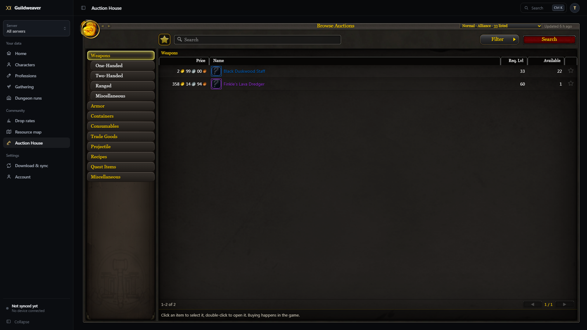
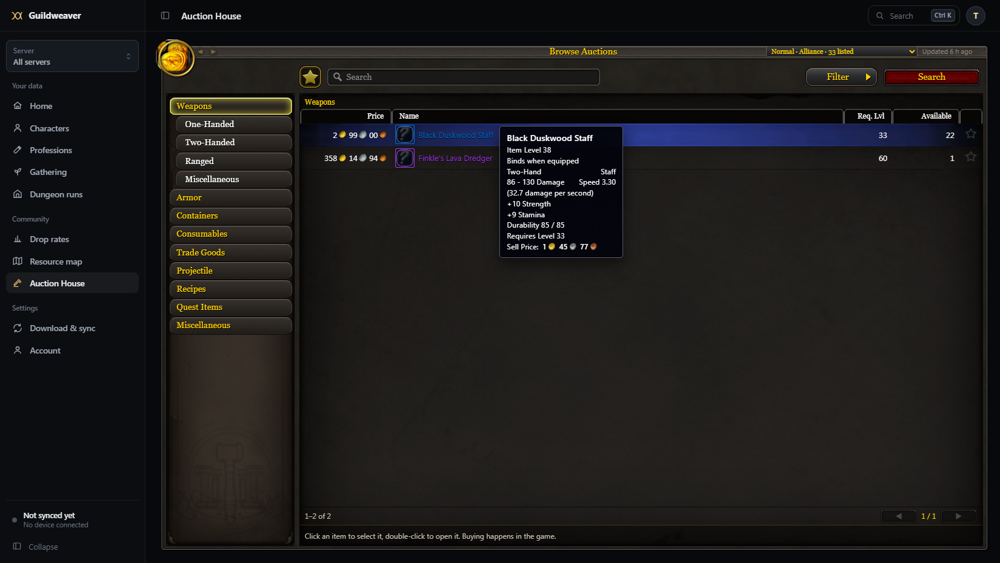
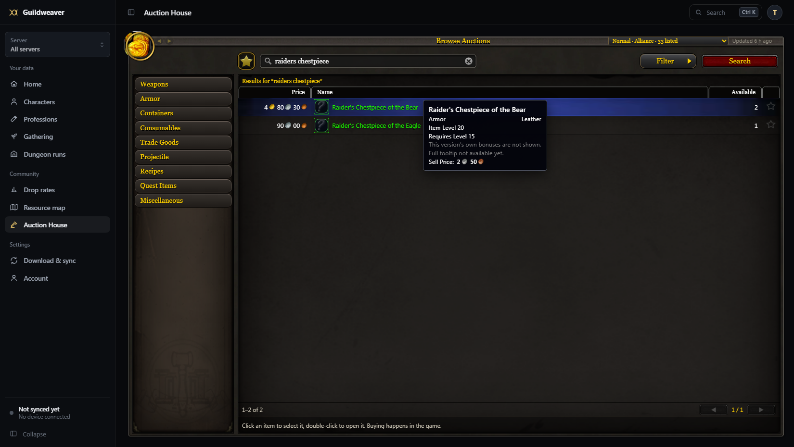
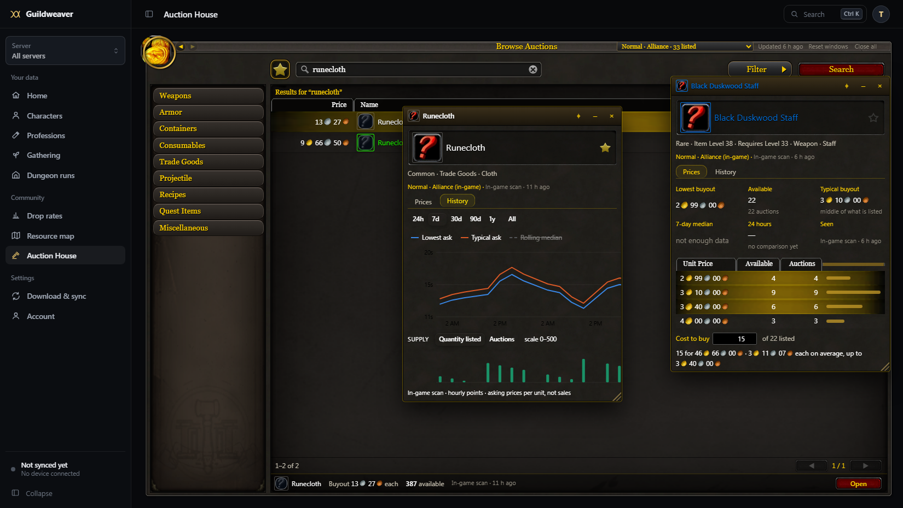

# Auction House data

How market data arrives, how it is stored, what is verified and what is not.

## Sources

| Source | What it is | Scope of one snapshot |
| --- | --- | --- |
| Blizzard API (`official_api`) | `/data/wow/ruleset/{id}/auctions/{house}` and `/commodities`, `dynamic-forever-{region}` | one endpoint of one house (`api:auctions`, `api:commodities`), each complete |
| In-game scan (`addon_scan`) | what a player's client showed: classic browse pages, "get all" scans, modern searches | a page or search (`items:<hash>`), or the whole house (`full`) |

Markets are never merged on their own. An in-game market (`game:<region>:<realm>:<faction>`) only counts toward an API house (`api:<region>:house-<id>`) after an administrator links them on the Diagnostics tab. Links are refused across regions or factions (Blackwater houses are `neutral`), and linking a second realm to the same house needs an explicit confirmation.

## Observations: retry, unchanged, new

Every observation is logged in `market_snapshot_checks` (14 days):

- **duplicate**: the same source id again (a retried upload, the same API generation). Nothing changes.
- **unchanged**: the same contents as the latest snapshot of the same scope, observed later. The snapshot's `confirmed_at` moves forward, history gets a point at the new time, and prices stay current. No second copy is stored.
- **not_modified**: Blizzard answered 304 for one endpoint. The market counts as checked, but its data keeps its own (older) age.
- **recorded**: new contents. A full snapshot that no longer lists an item records it as *none listed* (quantity 0), so supply falls to zero instead of the last price lingering. Partial views never imply anything about items they did not see.
- **too_old**: older than 7 days. Refused, so history is never rewritten.

Markets keep `last_checked_at`, `last_changed_at` and `last_full_at` separately.

## Choosing the price shown

From the latest complete and latest partial observation of each market and source (`selectObservation` in `marketModel.js`):

1. Recency first. A complete view is preferred over a newer partial one only while it is at most 6 hours older.
2. Within 45 minutes of the newest, sources are ranked: in-game scan, then Blizzard API, then provider. An older scan never beats a newer API snapshot.
3. Other recent sources that disagree by more than 15% are listed with their own prices. Confidence drops one level when they do.

Every summary keeps its reasons (`notes_json`). The website shows them under "why this price".

## Item variants

Prices, history, favorites, lists and crafting are keyed by variant (`i:<id>`, `i:<id>:s<suffix>`, `i:<id>:b<bonuses>`). Asking by item id prices the base item only. An item listed only as variants returns those variants (`variantsOnly`) and never borrows one's price. `/api/market/prices?keys=i:15210:s-1081` prices one exact variant (for tooltips).

## History and retention

| Table | Resolution | Kept | Used for |
| --- | --- | --- | --- |
| `market_observations` | each snapshot | 3 days, longer if a summary still shows it | evidence, choosing sources |
| `market_price_ladders` | latest per item, house and source | 14 days | the price levels and cost to buy in item windows, and `readItemOnMarket` |
| `market_series_hourly` | hour | 10 days (`MARKET_HOURLY_RETENTION_DAYS`) | 24 h and 7 d charts, 24 h change, 7-day median |
| `market_series_daily` | day | 400 days (`MARKET_DAILY_RETENTION_DAYS`) | 30 d – 1 y charts, 30-day median, volatility |
| `market_series_weekly` | week (from days) | 10 years | "All" |

Rows exist only where an observation exists; missing hours or days stay gaps. Only complete observations become history. Each bucket keeps low, high and close prices and quantities, sample count and first/last observation time. Maintenance runs daily (pruning, weekly roll-ups, 14-day reference prices for the Pct column) whether or not the Blizzard API is configured, and records itself for the Diagnostics tab.

Rough size: one hourly row is about 100 bytes. 15 houses × 5,000 listed items × 24 h × 10 days is about 18 million rows (1.8 GB) at the very most. Low-priority houses refresh every 4 hours and most items are not listed every hour, so expect a fraction of that. Lower `MARKET_HOURLY_RETENTION_DAYS` if needed; 7 is the minimum for the 7-day views. A price list (`market_price_ladders`) is one row per item, house and source with up to 200 levels, replaced on every new observation, so it does not grow with time.

### Retention audit (November 2026)

Checked against the code (`pruneMarketDataInDatabase`, `pruneSeriesInDatabase`, `rollUpWeeksInDatabase`) and the tests:

- Hourly, daily and weekly series are pruned at the ages above, nothing earlier. Weekly rows are built from days, which are kept far longer (400 days) than the roll-up reads (two weeks), so a week is complete before its days could go.
- **Fixed:** the weekly roll-up only read the last 15 days. A server stopped for more than about two weeks never rolled those weeks up, though their days were still there. It now reads back to its previous run (at most as far as days are kept); `rollUpWindowDays` has a test.
- A house that sells out now clears: a complete Blizzard answer with no auctions is recorded as an empty house (every item "No listings"), where before it was dropped and the last prices stayed. An answer without auctions and without Blizzard's usual `_links` is a failure, not an empty house.
- Observations older than 7 days are refused, so history is never rewritten.
- Listings that disappear are never counted as sales; the series hold asking prices and listed supply only.

## Metrics and observations

`GET /api/market/items/:id/analysis?market=&key=` returns:

- metrics: 24 h change, 7- and 30-day medians, 7- and 30-day ranges, daily volatility, price against the median, supply and auction counts against their 7-day medians, spikes and dips, coverage
- observations: below recent market, price spike, isolated cheap listing, supply rising or falling, volatile market

Each metric has its window, sample count and basis. Too little data returns `null` with a reason, not a number. Each observation has its window, samples, confidence and a one-line explanation. Listings that disappear are never counted as sales.

## Search and browse

Two different questions, kept apart:

1. **Which items match?** Search (`GET /api/market/search?market=&q=`) looks through the Auction House's item index, `market_item_meta`, which holds every item the website knows: the item descriptions players' add-ons sent (`public_game_items`), the item catalog (`game_data_catalog`, including Blizzard item data) and, as a last resort, names in-game scans showed. A background sync (`syncMarketCatalogInDatabase`, every 5 minutes, 2,000 rows a batch) keeps it in step; a search also indexes whatever arrived since the last batch before it runs.
2. **What is listed here?** Each match then gets the selected market's listings attached: one row per listed variant, at that variant's price in that market. Nothing is taken from another market or another variant.

Matching: an exact item id (`4319` or `#4319`), or every word of the name in any order, with case, accents, apostrophes and other punctuation folded (`searchKey` in `marketCategories.js`), so "raiders chestpiece" finds "Raider's Chestpiece". Variants also match by their own name ("of the Bear"). Results are ranked exact name, name starting with the text, a word starting with it, then the rest. Rows with listings always come before items without.

An item with nothing listed in the selected market is one row without a price, in one of two states:

| State | Meaning |
| --- | --- |
| `none_listed` (No listings) | A complete view of the house in the last 24 hours did not have it, or the item was seen and then gone in a complete view. Shown with the time of that view. |
| `unknown` (Not seen here) | The market has not been seen completely recently (in-game markets usually are only seen through individual searches), so the item may well be listed. |

A complete view is a Blizzard download with both its endpoints, or an in-game full scan. `listed=1` (what the page always asks for) leaves out the rows without listings and reports them apart, under `unlisted`.

Browse (no search text) shows only the market's listings, by category and filters. Catalog entries never appear there.

Suggestions while typing (`/api/market/suggest`) are a separate, smaller request: names starting with the text through an index range, then names containing every word, stopping at the first matches. They show a price only from the selected market and only the base item's own; variants are counted, never priced as the item.

Performance: a search over 40,000 catalog items with 10,000 listings takes a few tens of milliseconds (tested). Listings are joined by `(item_id, market_key)` for the matching items of one page; the page's details are read for that page only.

### Categories

`marketCategories.js` holds WoW Forever's own auction house categories, from the client's `Blizzard_AuctionData.lua` (Camelot), in the game's order: Weapons (One-Handed, Two-Handed, Ranged, Miscellaneous, each with its weapon types), Armor (Plate, Mail, Leather, Cloth by slot; Relic; Miscellaneous: Neck, Cloak, Finger, Trinket, Held In Off-hand, Shields, Shirt), Containers, Consumables, Trade Goods, Projectile, Recipes, Quest Items, Miscellaneous. Forever has no Gems, Glyphs or WoW Token categories, so neither does the website. `docs/AUCTION_HOUSE_UI.md` has the full tree and its source.

A category matches an item by class, subclass and, for armor slots, its equipment slot (`market_item_meta.inventory_type`, from the item's `equipLocation`; Chest also takes robes, as in the game). The same rules give the SQL filter and the counts. A link may name `category`, `sub` and `slot`; old links with class names still resolve.

An item no game data describes has no class, so it shows in searches only. In-game scans may carry `classId` and `subclassId` (from the client's `GetItemInfoInstant`) to place such items; game data always wins over them.

## The Auction House page

WoW Forever's Browse Auctions window (`docs/AUCTION_HOUSE_UI.md` has the measurements and sources), in the client's own art (`frontend/public/auction-art`, see its README), filling the dashboard's content area at any desktop size:

- **Title bar:** Back and Forward (they walk the Auction House's own steps: searches, categories, sorts, pages, houses; not row selection or opening a category), the auction house, how recently it was updated, and Diagnostics for administrators. The houses offered are the chosen server's Alliance, Horde and Blackwater houses, the player's faction first (from the race of their most recently seen character on that server), then Blizzard's houses. The house opened is the one you used last on that server, else your faction's if it has listings, else the next one with listings.
- **One screen, no tabs.** The website cannot buy or post; that happens in the game. Old Sell and Shopping links open Browse; shopping lists keep their data and API.
- **Search bar:** favorites, name or id with suggestions, Filter (level range; a checkbox per rarity, as in the game; the red X clears them), Search. Search searches the selected category.
- **Home** (nothing searched, no category): your favorites, priced on this house.
- **Categories:** as in the game: one selected path, shown open, with the yellow rim on each category of it and a gold bar on a third-level entry; clicking the selected category again selects its parent. A category with subcategories only opens (the results stay); Search then shows all of it. A category without subcategories shows its items at once. No counts and no "All …" entries.
- **Results:** Price, Name, Available (and Req. Lvl for Weapons, Armor and Consumables), sortable. A random-suffix version is listed under its own name ("Raider's Chestpiece of the Bear"). Search and categories show what is on the house; a search with nothing listed names the known items that matched and why ("No listings" after a complete view, "Not seen here" otherwise).
- **Tooltips** (icon or name, by mouse or keyboard focus): see "Item tooltips". They come with the page of results; hovering asks the server nothing.
- **One click** selects a row (kept in the link); **a double click**, Enter or Open opens the item's window.
- **Item windows:** one per item version, over the page. Drag, resize, raise, collapse, pin, close (Esc closes the one on top). Header: icon, name, tooltip, favorite. **Prices**: lowest and typical buyout, available and auctions, 7-day median, 24-hour change, freshness and source, then every price level the house showed (Unit Price, Available, Auctions, cheapest first) and **Cost to buy**: a quantity, walked level by level, with the average and highest price paid and how many are missing if fewer are listed. There is no seller column: neither Blizzard's API nor the add-on reports sellers. **History**: price and supply charts and metrics, loaded only there.
- **Dashboard home:** an "Auction House favorites" card with your favorites only: price on your house, 24-hour change, age, and a link to each.
- Links with `?item=` (Dungeon Companion loot) open that item's window; `?tab=history&item=` (the item catalog) opens it on History.

The screenshots use test data on a local server, not live prices. Icons show the game's question mark because a local server has no Blizzard credentials to fetch them.

## Item tooltips

Where an item's tooltip comes from, richest first (`tooltipsInDatabase` in `marketRepository.js`, the same for search results, favorites, item windows and the shared item service):

1. **A player's game rendered it**: the item descriptions players' add-ons send (`game_item_definition`, base item, sanitised into `public_game_items`), with the game build it came from.
2. **Blizzard's item API**: the display strings of `preview_item` (item level, binding, slot and type, damage and speed, armor, stats, durability, requirements, spell effects, description), kept with the item in `game_data_catalog`.
3. **Only the facts** (name, binding, the slot as the game names it, item and required level), ending "Full tooltip not available yet."

A random-suffix version shows its base item's lines under its own name and says "This version's own bonuses are not shown.": another version's bonuses are never borrowed. Private per-character item records (`item_definition`, used by the armory) are not used: they can carry instance details such as a crafter's name.

**Why production tooltips were nearly empty (fixed):** most listed items are known only through Blizzard's item API (the players' public catalog had about 1,650 items for build 70888). Items looked up before #276 were saved without tooltip text. The catalog treated them as fresh for 30 days, and the listed-item lookup skipped items that already had a name and class, so nothing asked Blizzard again. Now an item saved without tooltip text is refetched (`candidateList`), and the listed-item lookup includes such items once (`itemsMissingTooltipsInDatabase`, after the unnamed ones; a failed answer waits a day). At 240 items a minute the whole house is refetched within about an hour of deploying. **Not verified live:** whether Forever's item API returns `preview_item` (the Classic API does). If it does not, those items keep the facts-only tooltip until a player's add-on describes them; having the add-on describe items it sees at the auction house would close that gap (a follow-up in the add-on).

## Shared item service

`backend/src/Items/itemService.js` is how the rest of Guildweaver (professions, loot, farming, and later rules and MCP tools) asks about items, with the same data the Auction House shows and no React, request or page state:

| Function | Answers |
| --- | --- |
| `parseItemKey(value)` | an item id or key → `{ itemKey, itemId, suffix, bonusLists, variant }` |
| `readItem(key)`, `readItems(keys)` | name, quality, icon FileDataID, class, slot, levels, and the tooltip with its source and build |
| `readMarketPrices({ marketKey, keys })` | current lowest and typical buyout, quantity, auctions, freshness and source per item key, on one market |
| `readItemOnMarket({ key, marketKey })` | listing state, figures and every price level on one market |
| `readCostToBuy({ key, marketKey, quantity })` | the cost of a quantity, level by level |
| `readItemHistory({ key, marketKey, range })` | price and supply series with medians, ranges, volatility and supply change |
| `readItemSources(key)` | recipes that make or use it, and where players saw it drop |
| `readItemIntelligence({ key, marketKey, include })` | any of the above in one answer |

Item identity and market identity stay apart: a function that returns prices needs a market and never picks one; a version's key (`i:15210:s-1081`) is priced on its own and never merged with its base item. Prices are asking prices, not sales. It reads the existing repositories and adds no tables.

## Item icons

An icon is a FileDataID. `game_icon_assets` remembers, per icon, where its image was last found and whether a copy is stored; images themselves are never put in the database or on the server's disk. The icon routes (`/api/game/icons/:id`, `/api/intelligence/icons/:id`) answer only for icons of items the website knows, and try in order:

1. a stored copy in object storage (only with `ICON_STORAGE_*` set; a background job copies icons there every 5 minutes, JPEG, PNG or WebP up to 512 KB, checked by SHA-256),
2. the image URL Blizzard's item API gave for an item with that icon,
3. Blizzard's media search for that FileDataID.

The registry is in the database on the server's persistent disk, so it survives restarts; nothing is written to the server's own (temporary) file system. Every item image on the website goes through these routes. An icon none of them has is shown as the game's question mark and asked about again after an hour, doubling up to a week. In the page, an item tries its own image, then its icon by FileDataID, then the question mark. In-game scans may carry `iconFileDataId` (from `GetAuctionItemInfo`) so items no other source describes still get their icon.

## Names for items Blizzard's auction data lists

Blizzard's auction data lists item ids only. Every minute, up to 240 listed items the website cannot name or place in a category are looked up in Blizzard's item API (`resolveMarketItemNames`, through the same game data provider the rest of the website uses): Forever's static namespace first (`static-forever-{region}`, override with `MARKET_ITEM_NAMESPACE`), then `BLIZZARD_STATIC_NAMESPACES`. Answers go into the item catalog, then the Auction House's item index, so the item is searchable by name and sits in its category. Ids Blizzard does not know are asked again after a week. Needs `BLIZZARD_CLIENT_ID` / `BLIZZARD_CLIENT_SECRET`; the log says `[market] looked up … listed items`.

## Deploying

1. Run `npm run backup` first, as for any migration. Deploy as usual; migrations run on start.
   - The page that fills the screen and the tooltip refetch need no migration: after deploying, items saved without tooltip text are asked for again in the background (`[market] looked up … listed items` in the log).
   - Migration 20 adds `market_price_ladders` (each item's latest price levels), `market_item_meta.inventory_type` (the equipment slot, for armor categories) with two indexes, an index on the item catalog's icons, and `game_icon_assets` (the icon registry). It adds; it changes and deletes nothing.
   - Migration 19 adds `market_item_meta.lookup_at` (when Blizzard's item API was last asked about a listed item).
   - Migration 18 (search) adds two columns and two indexes to `market_item_meta`, one column to `market_variant_names`, and fills the search names of rows already there. It changes no other data. The item index then fills from game data in the background within a few minutes (`[market] indexed … catalog items for search` in the log).
   - Migration 17 rebuilt `market_snapshots` and `market_observations` (keeping their rows), moved `market_history` into `market_series_daily`, and added the series tables.
2. Optional: set `BLIZZARD_CLIENT_ID` / `BLIZZARD_CLIENT_SECRET` (server only), the `MARKET_*` variables and, to keep copies of icons, the `ICON_STORAGE_*` variables in `.env.example`.
3. Open Auction House → Diagnostics as an administrator. It should show each house checked within the hour, with both endpoints `recorded` or `not_modified`.

## Not verified yet

- **Blizzard Forever API:** implemented from community reports, tested only against a fake API. No credentials were available. With credentials, check on Diagnostics that houses are discovered (15 per region), both endpoints return data, `Last-Modified` advances about hourly, and 304s appear between generations.
- **Which API houses are which in-game markets:** never assumed. To verify a link: in game, at a known house, find a distinctive listing (an odd price or stack size) and note it. After the API house's next refresh, search the same item on the website in that API house and confirm the same listing. Then link the markets on Diagnostics. The link evidence table (items both saw within 3 hours, share with the same lowest ask) helps choose the house to check; it is never enough on its own.
- **The add-on on the live client:** see the Guildweaver README, "Auction House". The add-on does not yet send `iconFileDataId`, `classId` or `subclassId` with its scans (the website accepts them); until it does, items only scans have seen show without an icon or category.
- **Price levels from Blizzard:** the website keeps every level of Blizzard's answer (up to 200 per item); checked only against a fake API.
- **Tooltips from Blizzard's item API:** built from its `preview_item` display strings; checked against recorded examples, not live.
- **Icon copies in object storage:** tested against a fake store; no bucket was configured.
- **How much of the game the item index covers:** it knows only items some player's add-on described, items the Blizzard item API returned, and items scans named. In November 2026 the public catalog had about 1,100 described items per game build (Linen Cloth and Copper Ore, but not Azure Silk Gloves or Silk Cloth). Search finds an item as soon as one of those sources has it; it never invents one.

### Checking search and listings in a live client

1. Sign in, open Auction House. The window fills the page. With a character on the chosen server, the house shown is its faction's.
2. In the game, at an auctioneer, search an item that is listed (e.g. Linen Cloth) and one that is not. Close the auction house, `/gw sync`.
3. On the website, search both by name and by item id. The listed one shows the price you saw, "In-game scan · just now". The other gets no row; the page says "No auctions for … on this auction house" and names it as "Not seen here".
4. Click Trade Goods: it opens and the results do not change; press Search: all trade goods. Choose Cloth: only cloth. Click Armor: Trade Goods closes, the results stay. Press Back: the previous results return. Open Filter, clear Common: common items go; the red X brings them back.
5. Hover an item's name and icon: its tooltip matches the game's. For an item only Blizzard's data describes (most weapons and armor), the tooltip shows Blizzard's lines within about an hour of deploying, if Forever's item API provides them; otherwise the facts and "Full tooltip not available yet."
6. Double-click a row: the window's Prices tab lists the price levels you saw in the game (quantity and auctions per price). Type a quantity in Cost to buy and check it against buying that many in the game.
7. Switch to the matching Blizzard API house (if configured): the same item shows that house's price and levels or "No listings · <time>", never the in-game price.
8. Favorite an item, then open the dashboard's Home: the card shows it with this house's price.
9. As an administrator, Diagnostics shows the in-game market's last check at the time of your sync, and the server log shows `[market] looked up … listed items` while tooltips are being fetched.

