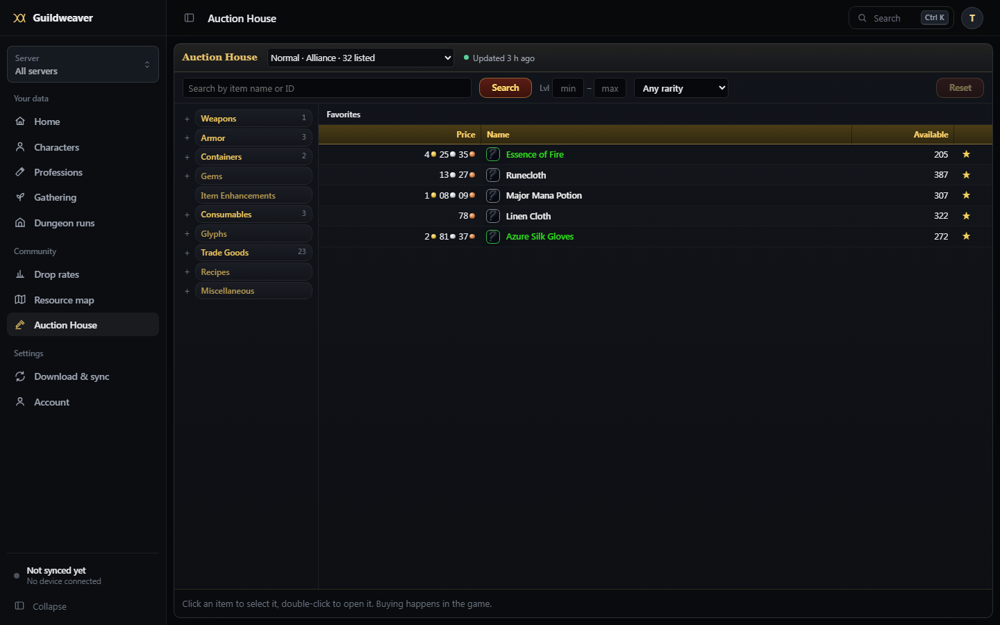
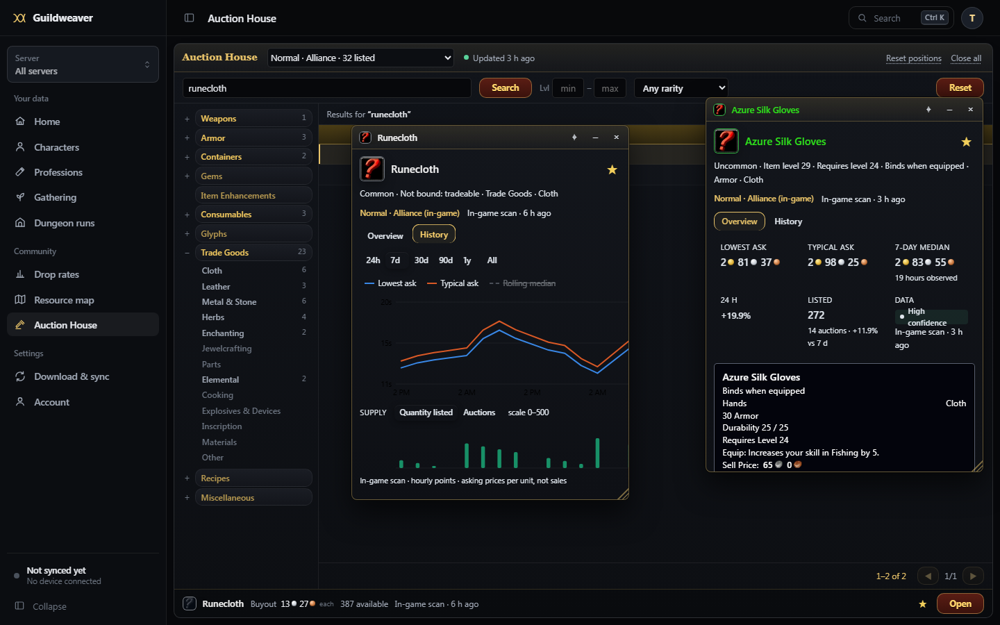

# Auction House data

How market data arrives, how it is stored, what is verified and what is not.

## Sources

| Source | What it is | Scope of one snapshot |
| --- | --- | --- |
| Blizzard API (`official_api`) | `/data/wow/ruleset/{id}/auctions/{house}` and `/commodities`, `dynamic-forever-{region}` | one endpoint of one house (`api:auctions`, `api:commodities`), each complete |
| In-game scan (`addon_scan`) | what a player's client showed: classic browse pages, "get all" scans, modern searches | a page or search (`items:<hash>`), or the whole house (`full`) |

Markets are never merged on their own. An in-game market (`game:<region>:<realm>:<faction>`) only counts toward an API house (`api:<region>:house-<id>`) after an administrator links them on the Diagnostics tab. Links are refused across regions or factions (Blackwater houses are `neutral`), and linking a second realm to the same house needs an explicit confirmation.

## Observations: retry, unchanged, new

Every observation is logged in `market_snapshot_checks` (14 days):

- **duplicate**: the same source id again (a retried upload, the same API generation). Nothing changes.
- **unchanged**: the same contents as the latest snapshot of the same scope, observed later. The snapshot's `confirmed_at` moves forward, history gets a point at the new time, and prices stay current. No second copy is stored.
- **not_modified**: Blizzard answered 304 for one endpoint. The market counts as checked, but its data keeps its own (older) age.
- **recorded**: new contents. A full snapshot that no longer lists an item records it as *none listed* (quantity 0), so supply falls to zero instead of the last price lingering. Partial views never imply anything about items they did not see.
- **too_old**: older than 7 days. Refused, so history is never rewritten.

Markets keep `last_checked_at`, `last_changed_at` and `last_full_at` separately.

## Choosing the price shown

From the latest complete and latest partial observation of each market and source (`selectObservation` in `marketModel.js`):

1. Recency first. A complete view is preferred over a newer partial one only while it is at most 6 hours older.
2. Within 45 minutes of the newest, sources are ranked: in-game scan, then Blizzard API, then provider. An older scan never beats a newer API snapshot.
3. Other recent sources that disagree by more than 15% are listed with their own prices. Confidence drops one level when they do.

Every summary keeps its reasons (`notes_json`). The website shows them under "why this price".

## Item variants

Prices, history, favorites, lists and crafting are keyed by variant (`i:<id>`, `i:<id>:s<suffix>`, `i:<id>:b<bonuses>`). Asking by item id prices the base item only. An item listed only as variants returns those variants (`variantsOnly`) and never borrows one's price. `/api/market/prices?keys=i:15210:s-1081` prices one exact variant (for tooltips).

## History and retention

| Table | Resolution | Kept | Used for |
| --- | --- | --- | --- |
| `market_observations` | each snapshot | 3 days, longer if a summary still shows it | evidence, choosing sources |
| `market_series_hourly` | hour | 10 days (`MARKET_HOURLY_RETENTION_DAYS`) | 24 h and 7 d charts, 24 h change, 7-day median |
| `market_series_daily` | day | 400 days (`MARKET_DAILY_RETENTION_DAYS`) | 30 d – 1 y charts, 30-day median, volatility |
| `market_series_weekly` | week (from days) | 10 years | "All" |

Rows exist only where an observation exists; missing hours or days stay gaps. Only complete observations become history. Each bucket keeps low, high and close prices and quantities, sample count and first/last observation time. Maintenance runs daily (pruning, weekly roll-ups, 14-day reference prices for the Pct column) whether or not the Blizzard API is configured, and records itself for the Diagnostics tab.

Rough size: one hourly row is about 100 bytes. 15 houses × 5,000 listed items × 24 h × 10 days is about 18 million rows (1.8 GB) at the very most. Low-priority houses refresh every 4 hours and most items are not listed every hour, so expect a fraction of that. Lower `MARKET_HOURLY_RETENTION_DAYS` if needed; 7 is the minimum for the 7-day views.

## Metrics and observations

`GET /api/market/items/:id/analysis?market=&key=` returns:

- metrics: 24 h change, 7- and 30-day medians, 7- and 30-day ranges, daily volatility, price against the median, supply and auction counts against their 7-day medians, spikes and dips, coverage
- observations: below recent market, price spike, isolated cheap listing, supply rising or falling, volatile market

Each metric has its window, sample count and basis. Too little data returns `null` with a reason, not a number. Each observation has its window, samples, confidence and a one-line explanation. Listings that disappear are never counted as sales.

## Search and browse

Two different questions, kept apart:

1. **Which items match?** Search (`GET /api/market/search?market=&q=`) looks through the Auction House's item index, `market_item_meta`, which holds every item the website knows: the item descriptions players' add-ons sent (`public_game_items`), the item catalog (`game_data_catalog`, including Blizzard item data) and, as a last resort, names in-game scans showed. A background sync (`syncMarketCatalogInDatabase`, every 5 minutes, 2,000 rows a batch) keeps it in step; a search also indexes whatever arrived since the last batch before it runs.
2. **What is listed here?** Each match then gets the selected market's listings attached: one row per listed variant, at that variant's price in that market. Nothing is taken from another market or another variant.

Matching: an exact item id (`4319` or `#4319`), or every word of the name in any order, with case, accents, apostrophes and other punctuation folded (`searchKey` in `marketCategories.js`), so "raiders chestpiece" finds "Raider's Chestpiece". Variants also match by their own name ("of the Bear"). Results are ranked exact name, name starting with the text, a word starting with it, then the rest. Rows with listings always come before items without.

An item with nothing listed in the selected market is one row without a price, in one of two states:

| State | Meaning |
| --- | --- |
| `none_listed` (No listings) | A complete view of the house in the last 24 hours did not have it, or the item was seen and then gone in a complete view. Shown with the time of that view. |
| `unknown` (Not seen here) | The market has not been seen completely recently (in-game markets usually are only seen through individual searches), so the item may well be listed. |

A complete view is a Blizzard download with both its endpoints, or an in-game full scan. `listed=1` (what the page always asks for) leaves out the rows without listings and reports them apart, under `unlisted`.

Browse (no search text) shows only the market's listings, by category and filters. Catalog entries never appear there.

Suggestions while typing (`/api/market/suggest`) are a separate, smaller request: names starting with the text through an index range, then names containing every word, stopping at the first matches. They show a price only from the selected market and only the base item's own; variants are counted, never priced as the item.

Performance: a search over 40,000 catalog items with 10,000 listings takes a few tens of milliseconds (tested). Listings are joined by `(item_id, market_key)` for the matching items of one page; the page's details are read for that page only.

### Categories

`marketCategories.js` maps the game's item class and subclass ids (from the add-on's `GetItemInfo` and Blizzard's item API) to the tree the Auction House shows: Weapons, Armor, Containers, Gems, Item Enhancements, Consumables, Glyphs, Trade Goods (Cloth, Leather, Metal & Stone, Herbs, Enchanting, Jewelcrafting, Parts, Elemental, …), Recipes, Miscellaneous. The same rules produce the SQL filter and the listing counts, and a test checks they agree for every class and subclass. Every category is always listed, with counts of listed items. Items whose data carries only English class names are mapped by name; old saved searches that stored class names still resolve. Classes outside the ten (projectiles, quivers, reagents, keys, quest items, pets) are filed under the nearest category: Ammunition under Weapons, Quivers under Containers, the rest under Miscellaneous.

An item no game data describes has no class, so it shows under "All categories" only. In-game scans may carry `classId` and `subclassId` (from the client's `GetItemInfoInstant`) to place such items; game data always wins over them.

## The Auction House page

One screen, like the game's:

- **Title bar:** the auction house, chosen per server. With a server picked in the dashboard, the list offers that server's Alliance, Horde and Blackwater houses, then Blizzard's houses linked to it or not yet matched to any server. With no data from that server yet, every house is offered and the page says so. How recently the house was updated sits next to it. Diagnostics is a small link there for administrators.
- **Search bar:** item name or id, Search (or Enter), level range, rarity, Reset.
- **Home** (nothing searched, no category): your favorites, priced on the chosen house.
- **Search and categories show what is on the house**, as in the game (`listed=1`). When a search finds nothing listed, the page names the known items that matched and whether a complete view had none ("No listings") or the house has not been seen completely ("Not seen here").
- **Table:** Price, Name, Available, sortable.
- **One click** selects a row and fills the bar under the table; **a double click** (or Enter) opens the item in a window.
- **Item windows:** one per item variant. Drag by the title bar (arrow keys on it; Shift+arrows resize), resize from the corner, click to bring forward, collapse, pin (stays above the others and through "Close all"), close (or Esc). Opening an item already open brings its window forward. Windows stay inside the browser window, are full width on phones, and are remembered for the browser session; "Reset positions" stacks them neatly. Each shows the item's tooltip as the game rendered it, its facts, this house's price, typical price, supply, freshness and source, and a favorite star. Its History tab has the price and supply charts, medians and volatility, loaded only there.
- Links with `?item=` (Dungeon Companion loot) open that item's window; `?tab=history&item=` (the item catalog) opens it on History.

The screenshots use test data on a local server, not live prices.

## Names for items Blizzard's auction data lists

Blizzard's auction data lists item ids only. Every minute, up to 240 listed items the website cannot name or place in a category are looked up in Blizzard's item API (`resolveMarketItemNames`, through the same game data provider the rest of the website uses): Forever's static namespace first (`static-forever-{region}`, override with `MARKET_ITEM_NAMESPACE`), then `BLIZZARD_STATIC_NAMESPACES`. Answers go into the item catalog, then the Auction House's item index, so the item is searchable by name and sits in its category. Ids Blizzard does not know are asked again after a week. Needs `BLIZZARD_CLIENT_ID` / `BLIZZARD_CLIENT_SECRET`; the log says `[market] looked up … listed items`.

## Deploying

1. Run `npm run backup` first, as for any migration. Deploy as usual; migrations run on start.
   - Migration 19 adds `market_item_meta.lookup_at` (when Blizzard's item API was last asked about a listed item).
   - Migration 18 (search) adds two columns and two indexes to `market_item_meta`, one column to `market_variant_names`, and fills the search names of rows already there. It changes no other data. The item index then fills from game data in the background within a few minutes (`[market] indexed … catalog items for search` in the log).
   - Migration 17 rebuilt `market_snapshots` and `market_observations` (keeping their rows), moved `market_history` into `market_series_daily`, and added the series tables.
2. Optional: set `BLIZZARD_CLIENT_ID` / `BLIZZARD_CLIENT_SECRET` (server only) and the `MARKET_*` variables in `.env.example`.
3. Open Auction House → Diagnostics as an administrator. It should show each house checked within the hour, with both endpoints `recorded` or `not_modified`.

## Not verified yet

- **Blizzard Forever API:** implemented from community reports, tested only against a fake API. No credentials were available. With credentials, check on Diagnostics that houses are discovered (15 per region), both endpoints return data, `Last-Modified` advances about hourly, and 304s appear between generations.
- **Which API houses are which in-game markets:** never assumed. To verify a link: in game, at a known house, find a distinctive listing (an odd price or stack size) and note it. After the API house's next refresh, search the same item on the website in that API house and confirm the same listing. Then link the markets on Diagnostics. The link evidence table (items both saw within 3 hours, share with the same lowest ask) helps choose the house to check; it is never enough on its own.
- **The add-on on the live client:** see the Guildweaver README, "Auction House".
- **How much of the game the item index covers:** it knows only items some player's add-on described, items the Blizzard item API returned, and items scans named. In November 2026 the public catalog had about 1,100 described items per game build (Linen Cloth and Copper Ore, but not Azure Silk Gloves or Silk Cloth). Search finds an item as soon as one of those sources has it; it never invents one.

### Checking search and listings in a live client

1. Sign in, open Auction House, pick your in-game market ("<realm> · Alliance (in-game)").
2. In the game, at an auctioneer, search an item that is listed (e.g. Linen Cloth) and one that is not. Close the auction house, `/gw sync`.
3. On the website, search both by name and by item id. The listed one shows the price you saw, "In-game scan · just now". The other gets no row; the page says "No auctions for … on this auction house" and names it as "Not seen here" (in-game houses are rarely seen completely).
4. Switch to the matching Blizzard API house (if configured): the same item shows that house's price or "No listings · <time>" after a complete download, never the in-game price.
5. Double-click a row: the inspector's tooltip matches the game's, and History shows a point at the time of your search. Open a second item, drag it beside the first, close both: the search and scroll are where you left them.
6. As an administrator, Diagnostics shows the in-game market's last check at the time of your sync.
